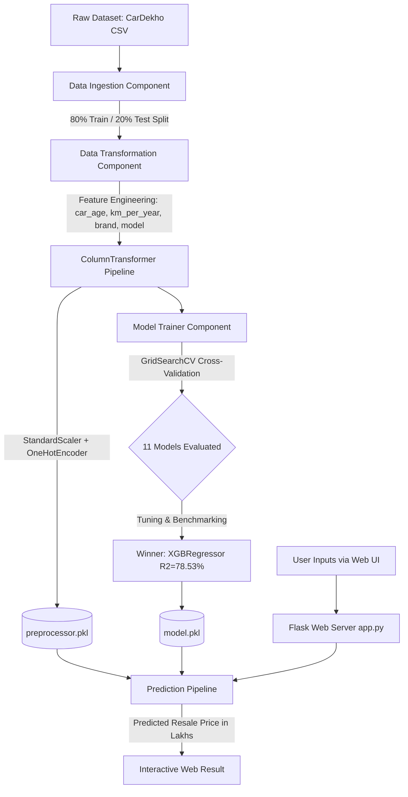

# 🚗 Vehicle Price Predictor - End-to-End Machine Learning Pipeline

[](https://www.python.org/)
[](https://scikit-learn.org/)
[](https://xgboost.ai/)
[](https://flask.palletsprojects.com/)
[](LICENSE)

An enterprise-ready, end-to-end Machine Learning web application designed to predict used car market valuations based on vehicle specifications, brand prestige, ownership records, and mileage wear. The system features a modular pipeline architecture, automated hyperparameter tuning (`GridSearchCV`), multi-model ensembling, and an interactive Flask web interface.

---

## 📌 Table of Contents
- [Project Overview](#-project-overview)
- [System Architecture](#-system-architecture)
- [Dataset & Feature Engineering](#-dataset--feature-engineering)
- [Model Evaluation & Leaderboard](#-model-evaluation--leaderboard)
- [Key Insights & Findings](#-key-insights--findings)
- [Repository Structure](#-repository-structure)
- [Installation & Quickstart](#-installation--quickstart)
- [Web Application Usage](#-web-application-usage)
- [Tech Stack](#-tech-stack)
- [Author & License](#-author--license)

---

## 📖 Project Overview

Determining the fair resale value of a used car is challenging due to complex multi-factor depreciation—including brand perception, usage intensity (km driven per year), gearbox type, fuel efficiency, and ownership tier. 

This project solves this problem by:
1. **Automating Data Ingestion & Transformation** with leak-proof preprocessing pipelines.
2. **Performing Advanced Feature Engineering** to capture depreciation dynamics.
3. **Training & Benchmarking 11 Regression Algorithms** with automated 3-Fold Cross-Validation (`GridSearchCV`).
4. **Deploying the Best Performing Model (`XGBRegressor`, $R^2 = 78.53\%$)** as an interactive, production-ready Flask web application.

---

## 🏗️ System Architecture



---

## 📊 Dataset & Feature Engineering

### 1. Raw Dataset Attributes
- **Source**: CarDekho Used Car Dataset (`4,340 samples × 8 raw features`)
- **Raw Features**: `name`, `year`, `km_driven`, `fuel`, `seller_type`, `transmission`, `owner`, `selling_price` (Target)

### 2. Feature Engineering Logic
| Engineered Feature | Derivation | Domain Significance |
| :--- | :--- | :--- |
| **`brand`** | `name.split()[0]` | Captures brand prestige (e.g., Maruti, Hyundai vs. BMW, Mercedes) |
| **`car_model`** | `' '.join(name.split()[:2])` | Groups vehicles by model series without overfitting to trim levels |
| **`car_age`** | `2026 - year` | Quantifies chronological vehicle age for direct depreciation modeling |
| **`km_per_year`** | `km_driven / (car_age + 1)` | Measures usage intensity (wear-and-tear per year of ownership) |

### 3. Preprocessing Pipeline (`ColumnTransformer`)
- **Numerical Pipeline**: `StandardScaler()` applied to `['year', 'km_driven', 'car_age', 'km_per_year']`.
- **Categorical Pipeline**: `OneHotEncoder(handle_unknown='ignore')` + `StandardScaler(with_mean=False)` applied to `['fuel', 'seller_type', 'transmission', 'owner', 'brand', 'car_model']`.
- Total encoded dimensionality: **225 features**.

---

## 🏆 Model Evaluation & Leaderboard

All models were evaluated on the held-out test dataset (20% split) using the **$R^2$ Score (Coefficient of Determination)**.

| Rank | Model | Test $R^2$ Score | Train $R^2$ Score | Status / Note |
| :---: | :--- | :---: | :---: | :--- |
| 🥇 | **XGBRegressor** | **0.7853 (78.53%)** | **0.9755** | 🏆 **Best Model (Selected for Production)** |
| 🥈 | **Extra Trees Regressor** | **0.7753 (77.53%)** | 0.9797 | Top Bagging Ensemble |
| 🥉 | **Voting Ensemble** | **0.7667 (76.67%)** | 0.9753 | Blend of XGBoost, CatBoost, RF, ExtraTrees |
| 4 | **CatBoosting Regressor** | **0.7465 (74.65%)** | 0.9572 | Strong categorical handling |
| 5 | **Gradient Boosting** | **0.7313 (73.13%)** | 0.9417 | Standard boosting baseline |
| 6 | **Random Forest** | **0.7089 (70.89%)** | 0.9667 | Standard bagging baseline |
| 7 | **Lasso Regression ($L_1$)** | **0.6888 (68.88%)** | 0.9008 | Best Linear Model (pruned sparse dummy columns) |
| 8 | **Ridge Regression ($L_2$)** | **0.6575 (65.75%)** | 0.9005 | $L_2$ Regularization with LSQR solver |
| 9 | **Linear Regression** | **0.6568 (65.68%)** | 0.9008 | Ordinary Least Squares baseline |
| 10 | **Decision Tree** | **0.6447 (64.47%)** | 0.9355 | Prone to higher variance |
| 11 | **AdaBoost Regressor** | **0.4242 (42.42%)** | 0.6500 | Sensitive to price outliers |

---

## 🔍 Key Insights & Findings

1. **Non-Linear Dynamics**: Tree-based ensembles (XGBoost, ExtraTrees, CatBoost) dramatically outperformed linear models, accurately reflecting non-linear depreciation curves and vehicle segment interactions.
2. **Lasso ($L_1$) vs. Ridge ($L_2$) Regularization**:
   - **Lasso** achieved **0.6888** (+3.2% over Linear Regression) by zeroing out coefficients for rare/uninformative one-hot encoded categories.
   - **Ridge** achieved **0.6575** with `alpha=100.0, solver='lsqr'`.
3. **Winning Hyperparameters (`XGBRegressor`)**:
   - `n_estimators`: `200`
   - `learning_rate`: `0.1`
   - `max_depth`: `6`

---

## 📁 Repository Structure

```text
Vehicle_price_predictor/
│
├── artifacts/                           # Serialized pipeline binaries & datasets
│   ├── data.csv                         # Full raw ingested dataset
│   ├── train.csv                        # 80% training split
│   ├── test.csv                         # 20% test split
│   ├── preprocessor.pkl                 # Fitted ColumnTransformer object
│   └── model.pkl                        # Best trained model (XGBRegressor)
│
├── notebook/
│   └── data/                            # Raw source data directory
│       └── CAR DETAILS FROM CAR DEKHO.csv
│
├── src/                                 # Core source code package
│   ├── __init__.py
│   ├── exception.py                     # Custom exception handler with traceback details
│   ├── logger.py                        # Timestamped logging configuration
│   ├── utils.py                         # Object persistence & model evaluation helpers
│   │
│   ├── components/                      # Modular pipeline components
│   │   ├── __init__.py
│   │   ├── data_ingestion.py            # Ingestion, split, and storage
│   │   ├── data_transformation.py       # Feature engineering & preprocessing pipeline
│   │   └── model_trainer.py             # Hyperparameter tuning & model selection
│   │
│   └── pipeline/                        # Execution pipelines
│       ├── __init__.py
│       ├── train_pipeline.py            # End-to-end retraining pipeline
│       └── predict_pipeline.py          # Real-time inference & feature packaging
│
├── templates/
│   └── index.html                       # Modern responsive web interface
│
├── app.py                               # Flask web server & routes
├── requirements.txt                     # Project dependencies
├── setup.py                             # Package installation configuration
└── README.md                            # Comprehensive project documentation
```

---

## 🚀 Installation & Quickstart

### 1. Prerequisites
- Python 3.10, 3.11, or 3.12+
- Git

### 2. Clone Repository
```bash
git clone https://github.com/your-username/Vehicle_price_predictor.git
cd Vehicle_price_predictor
```

### 3. Create & Activate Virtual Environment
```bash
# Windows (PowerShell)
python -m venv venv
venv\Scripts\Activate.ps1

# Linux / macOS
python3 -m venv venv
source venv/bin/activate
```

### 4. Install Dependencies
```bash
pip install --upgrade pip
pip install -r requirements.txt
```

### 5. Run the Training Pipeline (Optional)
To retrain all models from scratch and regenerate artifacts:
```bash
python src/pipeline/train_pipeline.py
```

### 6. Launch the Web Application
```bash
python app.py
```
Open your browser and navigate to:
```
http://127.0.0.1:5000/
```

---

## 🖥️ Web Application Usage

1. Open the web interface at `http://127.0.0.1:5000/`.
2. Input the car details:
   - **Year of Purchase** (e.g., `2018`)
   - **Total Kilometers Driven** (e.g., `45000`)
   - **Brand** (e.g., `Maruti`, `Hyundai`, `BMW`, `Honda`)
   - **Car Model** (e.g., `Maruti Swift`, `Honda City`)
   - **Fuel Type** (`Petrol`, `Diesel`, `CNG`, `LPG`, `Electric`)
   - **Seller Type** (`Individual`, `Dealer`, `Trustmark Dealer`)
   - **Transmission** (`Manual`, `Automatic`)
   - **Ownership** (`First Owner`, `Second Owner`, etc.)
3. Click **"Predict Vehicle Price"** to obtain:
   - Resale price in **Lakhs (₹)**
   - Formatted exact valuation in **INR**

---

## 🛠️ Tech Stack

- **Core**: Python 3.10+
- **Machine Learning**: Scikit-Learn, XGBoost, CatBoost
- **Data Manipulation**: Pandas, NumPy
- **Web Framework**: Flask, Jinja2
- **UI / Frontend**: HTML5, Vanilla CSS3 (Glassmorphism & responsive grid layout)
- **Serialization**: Pickle, Dill

---

